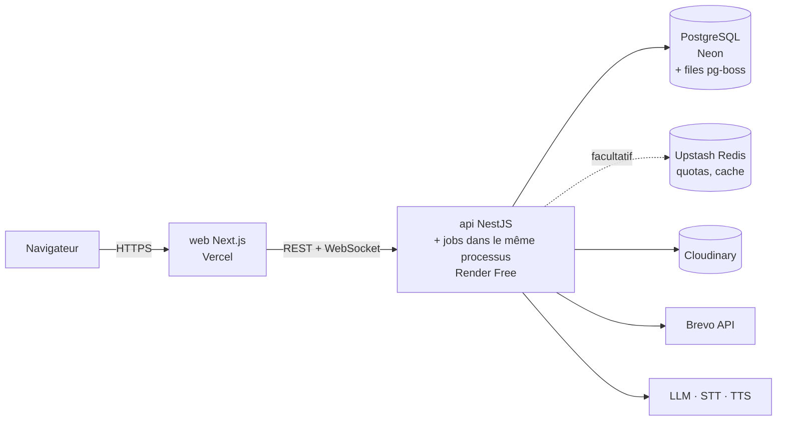
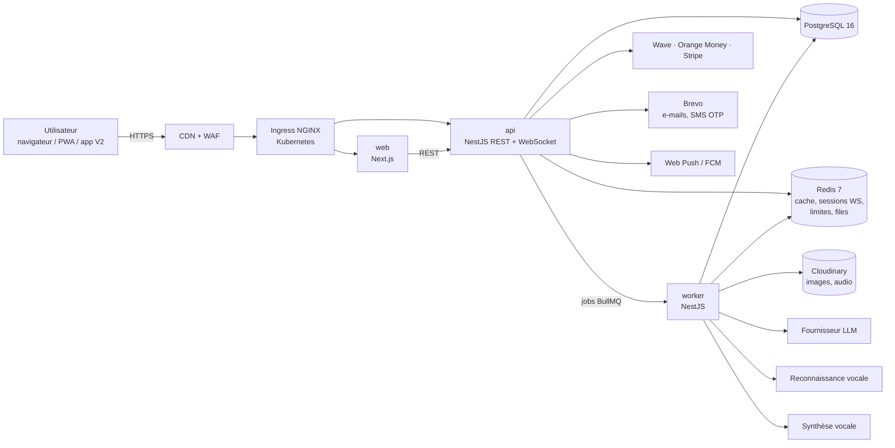
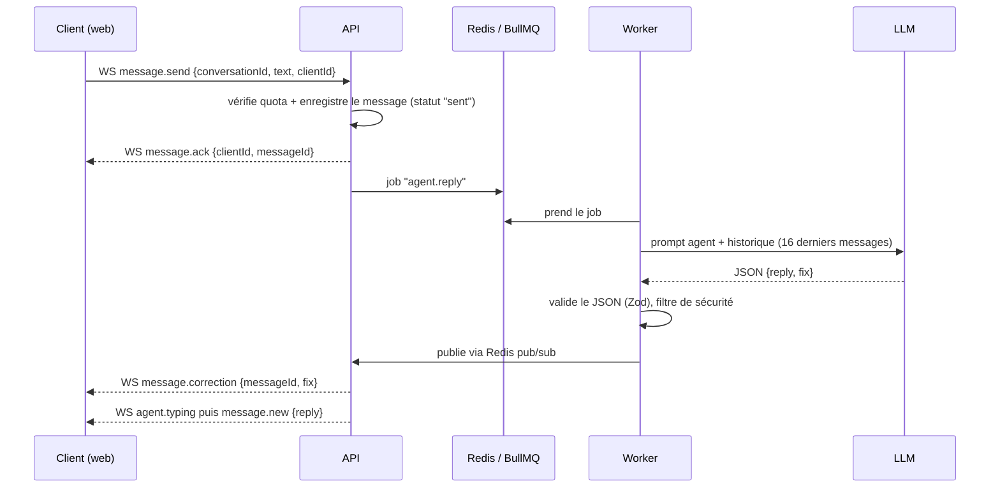

# 06 — Architecture

## Principes

- **Évolutif** : services sans état, mise à l'échelle horizontale, files d'attente pour les tâches lentes (IA, voix).
- **Disponible en continu** : plusieurs réplicas, déploiements progressifs sans coupure, migrations compatibles.
- **Remplaçable** : chaque fournisseur externe (IA, voix, SMS, paiement) passe par une interface ; on change de fournisseur sans toucher au métier.
- **Simple d'abord** : un monolithe modulaire (NestJS) + un worker. On ne découpe en microservices que si un module le justifie par sa charge.

## Vue d'ensemble

Le schéma ci-dessous est la **cible (phase 2)**. En **phase 1** (aperçu en ligne gratuit, voir `docs/10-devops.md`) la même architecture tourne en plus compact :



Les interfaces `Queue`, `Cache`, `Mailer`, `SmsSender` et `MediaStore` permettent de passer de l'une à l'autre en changeant seulement la configuration.

Cible (phase 2) :



## Monorepo

Outils : **pnpm** + **Turborepo**, Node.js 22 LTS, TypeScript 5 strict.

```text
new-start/
├── apps/
│   ├── web/            # Next.js 15 (App Router), PWA, Tailwind CSS, next-intl
│   ├── api/            # NestJS 11 : REST, WebSocket (Socket.IO), Prisma
│   ├── worker/         # NestJS standalone : jobs BullMQ (IA, voix, notifications, révisions)
│   └── mobile/         # V2 : Expo (React Native), réutilise packages/shared et packages/ui-native
├── packages/
│   ├── shared/         # Types, schémas Zod, constantes, codes d'erreur
│   ├── ui/             # Composants React + Storybook (design system)
│   ├── ai/             # Adaptateurs LLM / STT / TTS, gabarits de prompts, garde-fous
│   ├── payments/       # Adaptateurs Wave / Orange Money / Stripe
│   └── config/         # ESLint, tsconfig, Prettier, Tailwind preset
├── content/            # Épisodes de la série (JSON), fiches d'agents (seed)
├── data/               # Noyau d'anglais parlé (CSV)
├── infra/
│   ├── docker/         # Dockerfiles multi-étapes
│   ├── compose/        # docker-compose pour le développement
│   ├── helm/new-start/ # Chart Helm (web, api, worker)
│   └── k8s/            # Valeurs par environnement, Argo CD
├── .github/workflows/  # CI/CD
└── docs/
```

## Organisation du code en composants

L'organisation est fixée **dès le premier commit** et vérifiée automatiquement en CI (`dependency-cruiser` et `eslint-plugin-boundaries`) : un import interdit fait échouer le pipeline.

### Front (`apps/web`) : découpage par fonctionnalité

```text
apps/web/src/
├── app/                 # routes Next.js uniquement (pages, layouts) : aucune logique métier
├── features/            # une fonctionnalité = un dossier autonome
│   ├── chat/            #   components/, hooks/, api/, store/, index.ts (seule porte d'entrée)
│   ├── onboarding/
│   ├── series/
│   ├── games/
│   ├── progress/
│   └── billing/
├── entities/            # objets métier partagés côté interface : agent, user, message
├── shared/              # utilitaires transverses : client API, i18n, formatage, hooks génériques
└── styles/
```

Règles d'import : `app` → `features` → `entities` → `shared` → `packages/*`. Jamais l'inverse, jamais d'import d'une fonctionnalité vers une autre (elles communiquent par `entities` ou par l'URL).

### Bibliothèque de composants (`packages/ui`)

| Niveau | Exemples | Règle |
| --- | --- | --- |
| Primitives | `Button`, `Input`, `Dialog`, `Sheet`, `Avatar`, `Badge`, `Tabs`, `Switch`, `Skeleton` | Issues de shadcn/ui + Radix, variantes par `cva` |
| Composants | `ChatBubble`, `CorrectionCard`, `ContactRow`, `VoiceNote`, `GameTile`, `PlanOption` | Composés de primitives, sans appel réseau |
| Gabarits | `ChatLayout`, `TabLayout`, `CallLayout` | Mise en page des écrans |

Chaque composant : un fichier, ses variantes typées, une story Storybook (clair et sombre), un test d'accessibilité. Aucun composant de `packages/ui` ne connaît l'API ni l'état global.

### Back (`apps/api`, `apps/worker`) : modules en couches

```text
apps/api/src/modules/conversations/
├── domain/          # entités, règles métier pures (aucune dépendance à NestJS, Prisma, HTTP)
├── application/     # cas d'usage : SendMessage, ListConversations (orchestrent le domaine)
├── infrastructure/  # Prisma, Redis, adaptateurs IA (implémentent les ports du domaine)
├── interface/       # contrôleurs REST, passerelle WebSocket, DTO
└── conversations.module.ts
```

- Le domaine définit des **ports** (interfaces) ; l'infrastructure fournit les **adaptateurs**. On change de base, de file ou de fournisseur sans toucher au métier.
- Les modules communiquent par des **événements de domaine** (`MessageSent`, `EpisodeCompleted`, `SubscriptionActivated`) publiés sur la file (`Queue` : pg-boss en phase 1, BullMQ en phase 2), jamais en important les services d'un autre module.
- Un module peut sortir en service séparé le jour où sa charge le justifie, sans réécriture, puisqu'il ne dépend des autres que par ses événements et ses ports.

### Règles d'évolutivité

- **Sans état** : aucune donnée de session en mémoire du processus ; tout est en base, dans Redis ou dans le jeton.
- **Configuration par variables d'environnement** (principes des applications 12 facteurs), validée au démarrage par Zod.
- **Idempotence** de toutes les écritures rejouables (messages, webhooks, jobs).
- **Pagination par curseur** partout, aucune liste sans limite.
- **Tâches lentes en file** (IA, voix, e-mails, notifications), jamais dans la requête HTTP.
- **Cache** des lectures fréquentes (catalogue d'agents, offres, épisodes) dans Redis avec invalidation par événement.
- **Base de données** : index revus, lectures lourdes sur un réplica en lecture dès que la charge l'exige, pool de connexions (PgBouncer) devant PostgreSQL.
- **Limites et quotas** appliqués avant tout appel coûteux.

## Modules de l'API (NestJS)

| Module | Rôle |
| --- | --- |
| `auth` | OTP SMS, Google OAuth, JWT d'accès (15 min) + jeton de rafraîchissement rotatif (30 jours) |
| `users` | Profil, objectif, niveau, réglages (thème, rappel, accent, économie de données, pause) |
| `agents` | Catalogue des contacts IA, thèmes, fiches de personnalité |
| `conversations` | Conversations, messages, corrections ; passerelle WebSocket |
| `content` | Expressions, mots, épisodes, parcours 30 jours |
| `games` | Parties, questions générées depuis le noyau, scores |
| `reviews` | Révisions espacées (FSRS) |
| `progress` | XP, niveau, séries de jours, statistiques |
| `notifications` | Rappel quotidien, messages spontanés (≤ 1/jour), Web Push |
| `billing` | Offres, abonnements, quotas, webhooks de paiement |
| `media` | Téléversements signés vers Cloudinary (images, audio), transformations |
| `admin` | Gestion du contenu et des agents (accès réservé) |
| `health` | `/health/live`, `/health/ready` pour Kubernetes |

## Flux clé : un message dans une conversation



- Le client affiche « en train d'écrire… » dès l'accusé de réception.
- Si le LLM échoue : 2 nouvelles tentatives avec attente exponentielle, puis message système « Le message n'est pas passé. Renvoie-le. »
- `clientId` (UUID généré côté client) rend l'envoi **idempotent** : un renvoi après coupure réseau ne crée pas de doublon.

## Voix

- **Dictée et notes vocales (MVP)** : le client enregistre (Opus/WebM), envoie sur **Cloudinary** par téléversement signé, le worker transcrit (STT) et renvoie le texte.
- **Écouter (MVP)** : le worker génère l'audio (TTS) avec la voix fixe de l'agent ; résultat mis en cache sur Cloudinary par empreinte `hash(agentVoice + texte)`.
- **Appels en temps réel (V2)** : WebRTC via **LiveKit** (serveur auto-hébergé dans le cluster ou offre cloud) ; un « agent participant » enchaîne STT en flux → LLM → TTS en flux. Objectif de latence : < 1,2 s entre la fin de la phrase de l'utilisateur et le début de la réponse.
- **Vidéo (V3)** : avatar animé synchronisé sur l'audio TTS (fournisseur d'avatars à choisir sur un essai comparatif).

## Hors ligne (PWA)

- Service worker (Serwist) : cache de l'interface, des jeux de base et des 200 prochaines cartes de révision.
- File d'attente locale (IndexedDB) des réponses de jeu et des messages, synchronisée au retour du réseau.

## Choix techniques et alternatives

| Besoin | Choix | Pourquoi | Alternative |
| --- | --- | --- | --- |
| Front | Next.js 15 + Tailwind | Maîtrisé par l'équipe, SSR, PWA | Remix |
| API | NestJS 11 | Modulaire, typé, WebSocket intégré | Fastify seul |
| ORM | Prisma | Migrations, typage | Drizzle |
| Base | PostgreSQL 16 | Fiable, JSONB, extensions | — |
| Cache et files | Redis 7 + BullMQ (phase 2) ; pg-boss sur Postgres en phase 1, derrière la même interface `Queue` | Simple, éprouvé ; pg-boss évite un quota Redis gratuit | RabbitMQ |
| Temps réel | Socket.IO (une instance en phase 1) + adaptateur Redis (plusieurs réplicas en phase 2) | Reconnexion, salles, multi-réplicas | WebSocket natif |
| Appels | LiveKit (V2) | Open source, SDK web et mobile | Agora |
| Mobile | Expo (V2) | Partage de code TypeScript | Flutter |
| Recherche | PostgreSQL (trigram) | Suffisant au MVP | Meilisearch |
| Médias (images, audio) | **Cloudinary** (derrière l'interface `MediaStorage`) | Transformations d'images, CDN, offre gratuite | Stockage S3 |
| E-mails et SMS | **Brevo** (derrière les interfaces `Mailer` et `SmsSender`) | E-mails transactionnels et SMS OTP, offre gratuite pour les e-mails | Resend, Twilio |

## Budget de performance

| Mesure | Cible |
| --- | --- |
| LCP sur mobile 3G rapide | < 2,5 s |
| Poids JS initial | < 180 Ko compressés |
| p95 des routes REST | < 300 ms (hors IA) |
| Délai de la réponse d'un agent (texte) | p50 < 2,5 s, p95 < 6 s |
