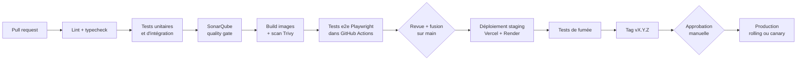

# 10 — DevOps : Docker, Kubernetes, CI/CD, SonarQube, supervision

Objectif : l'application tourne **en continu**, y compris pendant les mises à jour. Aucun déploiement ne coupe le service ; toute version se revert en moins de 5 minutes.

## Environnements

Le porteur du projet **développe et teste en local**, comme d'habitude, **dans Docker**, mais sa machine n'est pas très puissante. Donc : en local, des conteneurs légers (applis, PostgreSQL, faux serveur d'e-mails) ; **tout ce qui est lourd ou lié au déploiement tourne en ligne** (build des images Docker, SonarQube, tests e2e complets, hébergement, aperçus par PR).

| Environnement | Rôle | Déploiement | Données |
| --- | --- | --- | --- |
| `preview` | Un aperçu par pull request, pour tester avant fusion | Automatique à l'ouverture de la PR, supprimé à la fermeture | Données de démonstration (branche Neon de la PR) |
| `staging` | Préproduction en ligne dès le sprint 0 | Automatique à chaque fusion sur `main` | Données de test réalistes |
| `production` | Utilisateurs réels (phase 2) | Manuel, après approbation, depuis un tag `vX.Y.Z` | Réelles, sauvegardées |
| `local` | Développement et tests du porteur du projet et de Claude Code | `docker compose --profile dev up` (tout conteneurisé, version légère) | Seed |

Le projet avance en **deux phases**.

### Phase 1 — Aperçu en ligne avec des services gérés gratuits (maintenant)

Objectif : **voir l'application marcher en ligne**, le plus vite possible, sans serveur à administrer et sans dépenser. Décision du porteur du projet : services en ligne gratuits, les plus généreux. Les chiffres ont été relevés en novembre 2026 ; les offres gratuites changent souvent, donc Claude Code revérifie chaque limite au ticket NS-000 et signale tout changement.

| Besoin | Outil retenu | Ce que donne l'offre gratuite | Points d'attention |
| --- | --- | --- | --- |
| Front Next.js | **Vercel** (offre Hobby) | Un aperçu automatique par PR, 100 Go de transfert, 1 million d'invocations de fonctions, 4 heures de CPU actif, 100 déploiements par jour | Réservée à l'usage **personnel et non commercial** : parfait pour l'aperçu, à revoir avant d'activer le paiement (Vercel Pro ou phase 2) |
| API NestJS + jobs | **Render** (web service Free), image Docker construite par la CI | 750 heures d'instance par mois, WebSocket acceptés, aperçu par PR pour un service, pas de carte bancaire | **Se met en veille après 15 minutes sans trafic**, environ une minute pour se réveiller ; une seule instance ; pas de « background worker » gratuit, donc les jobs tournent **dans le même processus que l'API** ; disque effacé à chaque redéploiement (les fichiers vont sur Cloudinary) |
| PostgreSQL | **Neon** (offre Free) | 1 Go par projet, 100 CU-heures de calcul par projet et par mois, veille après 5 min, 10 branches maximum par projet, **branches** | Une branche par PR pour les aperçus (supprimer à la fermeture pour rester sous 10). Une API éveillée qui interroge la base la garde allumée : voir « Risques ouverts » dans `docs/decisions.md`. Ne pas utiliser la base gratuite de Render : elle est supprimée après 30 jours |
| Files de jobs | **pg-boss sur Neon**, derrière l'interface `Queue` | Pas de service en plus | BullMQ interroge Redis en continu et épuiserait vite un quota gratuit ; il reviendra en phase 2 sans changer le code métier |
| Cache et limites de débit | **Upstash Redis** (offre Free), facultatif | 500 000 commandes par mois | Seulement pour les quotas et le cache ; si le quota approche, repli sur Postgres. Avec une seule instance d'API, Socket.IO n'a pas besoin de l'adaptateur Redis |
| Qualité du code | **SonarQube Cloud** (offre Free) | Projets privés jusqu'à 50 000 lignes, publics illimités, analyse de chaque PR, quality gate | — |
| CI/CD, registre d'images | **GitHub Actions** + **GitHub Container Registry** | Illimité pour un dépôt public, quota mensuel pour un dépôt privé | Choix public ou privé en NS-000 |
| Médias | **Cloudinary** (offre Free) | Crédits mensuels partagés (montant à vérifier) | Choix du porteur du projet |
| E-mails | **Brevo** (offre Free) | 300 e-mails par jour | Render bloque les ports SMTP sortants (25, 465, 587) : passer par l'**API HTTP** de Brevo, pas par SMTP |
| SMS (plus tard) | **Brevo** | Crédits prépayés | Sur accord budgétaire |
| Erreurs | **Sentry** (offre Developer) | Quota mensuel d'erreurs (à vérifier) | — |
| Métriques et journaux | **Grafana Cloud** (offre Free) | 10 000 séries, 50 Go de journaux par mois | Facultatif en phase 1 : les journaux de Render et Vercel suffisent au début |
| Disponibilité | **UptimeRobot** ou **Better Stack** (offre Free) | Sondes toutes les 5 minutes environ (à vérifier) | Remplace Uptime Kuma, qui demanderait un serveur |
| DNS, HTTPS | Sous-domaines gratuits `*.vercel.app` et `*.onrender.com` ; **Cloudflare** si un domaine est acheté | — | Achat d'un domaine sur accord |
| Atelier de code en ligne (en secours) | **GitHub Codespaces** | Quota mensuel gratuit pour les comptes personnels (à vérifier) | Si une tâche est trop lourde pour la machine locale |

Ce que le porteur du projet doit savoir en testant :

- **Premier chargement lent** si personne n'a utilisé l'API depuis 15 minutes (environ une minute). Le front affiche un écran « Connexion au serveur… » au lieu d'une erreur, et la CI appelle `/health/ready` après chaque déploiement.
- Faut-il garder l'API éveillée par une sonde toutes les 10 minutes ? Les 750 heures gratuites couvrent un seul service allumé tout le mois, mais il n'en resterait plus pour les aperçus. Question posée en NS-000.
- Pas de haute disponibilité ni de mise à l'échelle : c'est un aperçu, pas la production.

Ce qui **n'est pas gratuit** et demande l'accord du porteur du projet : les appels aux fournisseurs d'IA (LLM, STT, TTS) au-delà de leurs crédits d'essai, les SMS, un nom de domaine. Claude Code affiche le coût réel dans le rapport hebdomadaire.

Sources des limites (novembre 2026) : [Render, offre gratuite](https://render.com/docs/free), [Vercel Hobby](https://vercel.com/docs/plans/hobby), [comparatif des hébergeurs gratuits, SnapDeploy](https://snapdeploy.dev/state-of-free-hosting), [Neon et Supabase, AgentDeals](https://agentdeals.dev/neon-vs-supabase), [Upstash, AgentDeals](https://agentdeals.dev/vendor/upstash), [SonarQube Cloud Free, Sonar](https://www.sonarsource.com/blog/choosing-sonarqube-free-tier/), [Grafana Cloud, AgentDeals](https://agentdeals.dev/vendor/grafana-cloud), [Brevo, aide Brevo](https://help.brevo.com/hc/en-us/articles/208589409).

Écartés pour la phase 1 : **Koyeb** (empreinte de 29 $ sur la carte depuis février 2026, pas de worker gratuit), **Fly.io** (plus d'offre gratuite pour les nouveaux comptes), **Railway** (5 $ de crédit d'essai puis 1 $ par mois), **Oracle Always Free + k3s** (serveur à administrer soi-même ; réservé à la phase 2 si choisi).

### Règles pour que la phase 2 ne demande aucune réécriture

- Le code ne dépend d'aucun hébergeur : configuration par variables d'environnement, accès aux services par des **interfaces** (`Queue`, `Cache`, `Mailer`, `SmsSender`, `MediaStore`) avec un adaptateur par fournisseur.
- L'API démarre en mode `RUN_JOBS=inline` (jobs dans le même processus) en phase 1, et en mode séparé (`apps/worker`) en phase 2. Le même code tourne dans les deux cas.
- Les Dockerfiles, le chart Helm et les manifestes Kubernetes sont **écrits et vérifiés dès le sprint 0** (lint Helm, `kubeconform`, build des images, scan Trivy), mais déployés seulement en phase 2.

### Phase 2 — VPS ou AWS (plus tard, à décider)

Quand l'aperçu est validé, Claude Code prépare un **comparatif de coûts** et le porteur du projet choisit. Rien n'est créé sur AWS ni chez un hébergeur sans son accord.

| Option | Ce qu'on déploie | Ce qu'il faut vérifier |
| --- | --- | --- |
| **VPS** (un ou deux serveurs, prix fixe mensuel) | k3s, chart Helm, Argo CD, Redis et BullMQ, Postgres managé (Neon) ou sur le serveur | Prix mensuel réel, localisation (latence depuis Dakar), sauvegardes |
| **AWS avec les crédits du porteur du projet** | Option économique : une instance EC2 avec k3s + Neon. Option complète : EKS + RDS + ElastiCache | Montant et date d'expiration des crédits, services couverts. EKS facture le plan de contrôle à l'heure (environ 73 $ par mois) en plus des machines : à éviter tant que les crédits sont petits |

Avant tout usage d'AWS : **alerte de budget AWS Budgets** à un montant fixé par le porteur du projet, région choisie avec lui, et estimation faite avec l'AWS Pricing Calculator jointe au comparatif. Le comparatif indique le coût mensuel une fois les crédits épuisés.

## Docker

Une image par application, construite en plusieurs étapes, exécutée sans droits root.

```dockerfile
# infra/docker/api.Dockerfile
FROM node:22-alpine AS base
RUN corepack enable
WORKDIR /repo

FROM base AS deps
COPY pnpm-lock.yaml pnpm-workspace.yaml package.json ./
COPY apps/api/package.json apps/api/
COPY packages/ packages/
RUN pnpm install --frozen-lockfile --filter @newstart/api...

FROM deps AS build
COPY . .
RUN pnpm --filter @newstart/api... build \
 && pnpm --filter @newstart/api deploy --prod /out

FROM node:22-alpine AS runtime
ENV NODE_ENV=production
WORKDIR /app
RUN addgroup -S app && adduser -S app -G app
COPY --from=build --chown=app:app /out ./
USER app
EXPOSE 3000
HEALTHCHECK CMD wget -qO- http://localhost:3000/health/live || exit 1
CMD ["node", "dist/main.js"]
```

Règles : images basées sur des versions figées, étiquetées par le SHA du commit et par la version (`ghcr.io/<org>/newstart-api:1.4.2`), scannées par **Trivy** (échec du pipeline sur toute vulnérabilité `CRITICAL`).

### Développement local avec Docker

Le porteur du projet a **Docker sur sa machine** : tout ce qui tourne en local est **conteneurisé**, rien d'autre à installer que Docker (Node et pnpm deviennent facultatifs). Sa machine étant modeste, tout est réglé pour rester léger.

Trois façons de lancer, du plus léger au plus complet :

| Commande | Ce qui démarre | Usage |
| --- | --- | --- |
| `docker compose up -d` | PostgreSQL + Mailpit | Dépendances seules, applis lancées avec `pnpm dev` si Node est installé |
| `docker compose --profile dev up` | + `web` et `api` en conteneurs de développement, code monté en volume, **rechargement automatique** | Travail quotidien, sans Node sur la machine |
| `docker compose --profile prod up --build` | `web` et `api` construits avec les Dockerfiles de production | Vérifier avant une PR que l'image finale marche, comme en ligne |

Options : `--profile redis` ajoute Redis, `--profile quality` ajoute SonarQube (lourd : environ 2 Go de RAM, à lancer rarement ; l'analyse en ligne sur chaque PR suffit en général).

Règles pour une machine modeste :

- **Limites de mémoire** sur chaque conteneur (`mem_limit`) ; cible : moins de 2 Go au total avec le profil `dev`.
- Les jobs tournent dans le processus de l'API (`RUN_JOBS=inline`) avec la file pg-boss : pas de conteneur worker à part.
- `node_modules` et le cache pnpm dans des **volumes Docker nommés**, pour ne pas tout réinstaller à chaque démarrage.
- On peut ne lancer qu'une appli : `docker compose --profile dev up web`.
- Les fournisseurs d'IA, Brevo et Cloudinary ont des **adaptateurs factices** pour développer sans clé et sans coût ; le vrai fournisseur s'active par une variable.
- Les tests e2e complets sur tous les navigateurs tournent dans la CI ; en local, un seul navigateur.
- Ménage : `pnpm docker:clean` (`docker system prune` sur les images du projet) quand le disque se remplit.

```yaml
# infra/compose/docker-compose.yml (extrait)
x-dev-app: &dev-app
  image: node:22-alpine
  working_dir: /repo
  command: sh -c "corepack enable && pnpm install && pnpm --filter $$APP dev"
  volumes:
    - ../..:/repo
    - node_modules:/repo/node_modules
    - pnpm_store:/root/.local/share/pnpm/store
  env_file: ../../.env.local
  depends_on: [postgres, mailpit]
  profiles: ["dev"]
  mem_limit: 768m

services:
  postgres:
    image: postgres:16-alpine
    environment: { POSTGRES_USER: ns, POSTGRES_PASSWORD: ns, POSTGRES_DB: newstart }
    ports: ["5432:5432"]
    volumes: [pg:/var/lib/postgresql/data]
    mem_limit: 256m
  mailpit:
    image: axllent/mailpit:latest
    ports: ["8025:8025"]
    mem_limit: 64m
  web:
    <<: *dev-app
    environment: { APP: "@newstart/web" }
    ports: ["3000:3000"]
  api:
    <<: *dev-app
    environment: { APP: "@newstart/api", RUN_JOBS: inline }
    ports: ["4000:4000"]
  web-prod:
    build: { context: ../.., dockerfile: infra/docker/web.Dockerfile }
    ports: ["3000:3000"]
    profiles: ["prod"]
  api-prod:
    build: { context: ../.., dockerfile: infra/docker/api.Dockerfile }
    environment: { RUN_JOBS: inline }
    ports: ["4000:3000"]
    depends_on: [postgres]
    profiles: ["prod"]
  redis:
    image: redis:7-alpine
    ports: ["6379:6379"]
    profiles: ["redis"]
    mem_limit: 128m
  sonarqube:
    image: sonarqube:lts-community
    ports: ["9002:9000"]
    profiles: ["quality"]

volumes: { pg: {}, node_modules: {}, pnpm_store: {} }
```

Épingler des versions précises des images (pas de `latest`) avant le premier commit. Sous Windows, le dépôt est cloné dans WSL 2 pour que le rechargement automatique reste rapide.

## Kubernetes (phase 2)

Écrit et vérifié en CI dès le sprint 0, déployé seulement en phase 2 (VPS ou AWS).

Déploiement par **chart Helm** `infra/helm/new-start` (trois déploiements : `web`, `api`, `worker`) et **Argo CD** en GitOps : le cluster suit le dépôt, chaque changement est tracé et réversible.

### Déploiement sans coupure

```yaml
# extrait de templates/api-deployment.yaml
apiVersion: apps/v1
kind: Deployment
metadata:
  name: api
spec:
  replicas: 3
  revisionHistoryLimit: 5
  strategy:
    type: RollingUpdate
    rollingUpdate:
      maxUnavailable: 0   # aucun pod retiré avant que le nouveau soit prêt
      maxSurge: 1
  selector:
    matchLabels: { app: api }
  template:
    metadata:
      labels: { app: api }
    spec:
      terminationGracePeriodSeconds: 40
      securityContext: { runAsNonRoot: true }
      containers:
        - name: api
          image: ghcr.io/ORG/newstart-api:{{ .Values.image.tag }}
          ports: [{ containerPort: 3000 }]
          envFrom: [{ secretRef: { name: api-secrets } }, { configMapRef: { name: api-config } }]
          resources:
            requests: { cpu: 250m, memory: 384Mi }
            limits: { memory: 768Mi }
          readinessProbe:
            httpGet: { path: /health/ready, port: 3000 }
            periodSeconds: 5
            failureThreshold: 3
          livenessProbe:
            httpGet: { path: /health/live, port: 3000 }
            initialDelaySeconds: 20
            periodSeconds: 10
          lifecycle:
            preStop: { exec: { command: ["sh", "-c", "sleep 10"] } }  # laisse l'Ingress retirer le pod
      topologySpreadConstraints:
        - maxSkew: 1
          topologyKey: kubernetes.io/hostname
          whenUnsatisfiable: ScheduleAnyway
          labelSelector: { matchLabels: { app: api } }
---
apiVersion: policy/v1
kind: PodDisruptionBudget
metadata: { name: api }
spec:
  minAvailable: 2
  selector: { matchLabels: { app: api } }
---
apiVersion: autoscaling/v2
kind: HorizontalPodAutoscaler
metadata: { name: api }
spec:
  scaleTargetRef: { apiVersion: apps/v1, kind: Deployment, name: api }
  minReplicas: 3
  maxReplicas: 20
  metrics:
    - type: Resource
      resource: { name: cpu, target: { type: Utilization, averageUtilization: 65 } }
```

Points obligatoires :

- **Arrêt propre** : à `SIGTERM`, l'API cesse d'accepter des requêtes, termine les requêtes en cours, ferme les WebSocket avec un code de reconnexion ; le worker finit son job en cours ou le remet dans la file.
- **WebSocket** : adaptateur Redis de Socket.IO pour que n'importe quel réplica puisse joindre n'importe quel utilisateur ; le client se reconnecte automatiquement.
- **Worker** : mise à l'échelle sur la longueur de la file avec **KEDA** (déclencheur Redis/BullMQ).
- **Ingress NGINX** + **cert-manager** (certificats Let's Encrypt), HTTP/2, compression, en-têtes de sécurité.
- **Secrets** : jamais dans Git en clair. External Secrets Operator (relié au coffre de l'hébergeur) ou Sealed Secrets.
- **NetworkPolicies** : seuls `api` et `worker` joignent la base et Redis.

### Migrations de base sans coupure

Les migrations Prisma tournent dans un **Job Helm `pre-upgrade`** avant le déploiement des nouveaux pods. Elles suivent toujours « étendre puis contracter » :

1. **Étendre** (version N) : ajouter la nouvelle colonne ou table, nullable ou avec valeur par défaut. L'ancien code fonctionne toujours.
2. **Migrer** (version N) : le code écrit dans l'ancienne et la nouvelle colonne ; un job recopie les données existantes.
3. **Basculer** (version N+1) : le code lit la nouvelle colonne.
4. **Contracter** (version N+2) : suppression de l'ancienne colonne.

Interdit dans une seule version : renommer ou supprimer une colonne utilisée, ajouter une contrainte `NOT NULL` sans valeur par défaut, verrouiller une grosse table (index créés `CONCURRENTLY`).

### Fonctionnalités activables

Les nouvelles fonctionnalités sortent **désactivées** derrière un drapeau (Unleash auto-hébergé ou table `FeatureFlag`), activées progressivement : 5 % → 25 % → 100 % des utilisateurs. On désactive un drapeau au lieu de redéployer en cas de problème.

### Déploiement progressif en production (V2)

Argo Rollouts en mode **canary** : 10 % du trafic pendant 10 minutes, analyse automatique (taux d'erreur 5xx < 1 %, p95 < 500 ms), puis 50 %, puis 100 %. Retour arrière automatique si l'analyse échoue.

## CI/CD (GitHub Actions) — en place avant la première fonctionnalité

Les pipelines sont livrés au **sprint 0, avant toute ligne de code métier** : aucun ticket de fonctionnalité ne démarre tant que la CI, le quality gate et le déploiement automatique sur staging ne fonctionnent pas.

| Workflow | Déclencheur | Ce qu'il fait |
| --- | --- | --- |
| `ci.yml` | Chaque PR et chaque push | Lint, typecheck, contrôle des imports entre couches, tests unitaires et d'intégration, couverture, SonarQube + quality gate, build des images, scan Trivy |
| `e2e.yml` | Chaque PR touchant l'interface | Tests Playwright (mobile et ordinateur, clair et sombre), accessibilité axe, captures comparées |
| `preview.yml` | Ouverture et mise à jour d'une PR | Phase 1 : crée la branche Neon de la PR, migre et charge la démo ; Vercel déploie le front de la PR, Render l'aperçu de l'API si la PR la touche ; commente les liens dans la PR ; supprime la branche Neon à la fermeture. Phase 2 : aperçu `pr-<n>` dans le cluster |
| `cd-staging.yml` | Fusion sur `main` | Publie les images ; phase 1 : migration Prisma sur Neon, appel du « deploy hook » Render avec la nouvelle image, déploiement Vercel ; phase 2 : Argo CD. Puis tests de fumée |
| `release.yml` | Tag `vX.Y.Z` | Notes de version, puis production après approbation du porteur du projet (phase 2) |
| `nightly.yml` | Chaque nuit | Tests e2e complets sur staging avec les vrais fournisseurs en mode test, évaluations IA, audit des dépendances, scan OWASP ZAP |
| `codeql.yml` | Chaque PR et chaque semaine | Analyse de sécurité du code |




```yaml
# .github/workflows/ci.yml (extrait)
name: ci
on:
  pull_request:
  push: { branches: [main] }
concurrency: { group: "ci-${{ github.ref }}", cancel-in-progress: true }
jobs:
  quality:
    runs-on: ubuntu-latest
    services:
      postgres: { image: "postgres:16-alpine", env: { POSTGRES_PASSWORD: ns }, ports: ["5432:5432"] }
      redis: { image: "redis:7-alpine", ports: ["6379:6379"] }
    steps:
      - uses: actions/checkout@v4
        with: { fetch-depth: 0 }          # historique complet pour SonarQube
      - uses: pnpm/action-setup@v4
      - uses: actions/setup-node@v4
        with: { node-version: 22, cache: pnpm }
      - run: pnpm install --frozen-lockfile
      - run: pnpm lint && pnpm typecheck
      - run: pnpm test -- --coverage
        env: { DATABASE_URL: "postgresql://postgres:ns@localhost:5432/postgres" }
      - uses: SonarSource/sonarqube-scan-action@v5
        env:
          SONAR_TOKEN: ${{ secrets.SONAR_TOKEN }}
          SONAR_HOST_URL: ${{ secrets.SONAR_HOST_URL }}
      - uses: SonarSource/sonarqube-quality-gate-action@v1
        timeout-minutes: 5
        env: { SONAR_TOKEN: "${{ secrets.SONAR_TOKEN }}" }
  images:
    needs: quality
    runs-on: ubuntu-latest
    strategy: { matrix: { app: [web, api, worker] } }
    steps:
      - uses: actions/checkout@v4
      - uses: docker/setup-buildx-action@v3
      - uses: docker/login-action@v3
        with: { registry: ghcr.io, username: "${{ github.actor }}", password: "${{ secrets.GITHUB_TOKEN }}" }
      - uses: docker/build-push-action@v6
        with:
          file: infra/docker/${{ matrix.app }}.Dockerfile
          push: ${{ github.ref == 'refs/heads/main' }}
          tags: ghcr.io/${{ github.repository_owner }}/newstart-${{ matrix.app }}:${{ github.sha }}
          cache-from: type=gha
          cache-to: type=gha,mode=max
      - uses: aquasecurity/trivy-action@0.28.0
        with:
          image-ref: ghcr.io/${{ github.repository_owner }}/newstart-${{ matrix.app }}:${{ github.sha }}
          severity: CRITICAL
          exit-code: "1"
```

Vérifier les versions des actions au moment de créer le fichier et les épingler par SHA de commit (sécurité de la chaîne d'approvisionnement). Les mises à jour de dépendances passent par **Renovate**.

## SonarQube

- Instance : SonarQube Community auto-hébergée (conteneur dans le cluster, base PostgreSQL dédiée) ou SonarCloud si le dépôt est public.
- Un projet par dépôt, analyse à chaque PR et à chaque fusion.

```properties
# sonar-project.properties
sonar.projectKey=newstart
sonar.projectName=New Start
sonar.sources=apps,packages
sonar.exclusions=**/node_modules/**,**/dist/**,**/.next/**,**/*.spec.ts,**/*.test.ts,**/generated/**
sonar.tests=apps,packages
sonar.test.inclusions=**/*.spec.ts,**/*.test.ts,**/*.spec.tsx,**/*.test.tsx
sonar.javascript.lcov.reportPaths=apps/*/coverage/lcov.info,packages/*/coverage/lcov.info
sonar.qualitygate.wait=true
```

**Quality gate « New Start »** (sur le nouveau code) : 0 nouveau bug, 0 nouvelle vulnérabilité, 100 % des points sensibles de sécurité revus, couverture ≥ 80 %, duplication ≤ 3 %, note de maintenabilité A. La fusion est bloquée si le gate est rouge (règle de protection de branche).

## Supervision et alertes

En phase 1, Sentry et les journaux de Render et Vercel suffisent ; OpenTelemetry vers Grafana Cloud s'ajoute dès que le volume le justifie. Les SLO ci-dessous s'appliquent à la production (phase 2).

| Outil | Rôle |
| --- | --- |
| OpenTelemetry | Traces et métriques depuis web, api, worker |
| Grafana Cloud (phase 1), Prometheus + Grafana (phase 2) | Métriques, tableaux de bord (trafic, erreurs, latence, files, coût IA) |
| Loki | Journaux centralisés (JSON, sans données personnelles) |
| Sentry | Erreurs front et back, avec version de release |
| UptimeRobot ou Better Stack (phase 1), Uptime Kuma (phase 2) | Sondes externes depuis l'Afrique de l'Ouest et l'Europe |

Objectifs de service (SLO) : disponibilité 99,5 % au MVP (99,9 % ensuite), p95 API < 300 ms hors IA, réponse d'agent p95 < 6 s. Alertes vers un canal d'astreinte quand le budget d'erreur se consomme trop vite.

## Sauvegardes et reprise

- Phase 1 : restauration à un instant donné fournie par Neon (fenêtre de l'offre gratuite, à vérifier) et export `pg_dump` hebdomadaire par un workflow GitHub Actions, stocké en artefact privé.
- Phase 2 — PostgreSQL : sauvegarde complète quotidienne + journaux continus (restauration à la minute près sur 7 jours), copie dans une autre région.
- Test de restauration **chaque mois** sur staging, documenté.
- Médias (Cloudinary) : audio brut supprimé à 30 jours par un job planifié ; illustrations de la série conservées aussi dans le dépôt de contenu.
- Objectifs : perte de données maximale 5 minutes (RPO), remise en service en moins d'1 heure (RTO).

## Procédure de mise en production (phase 2)

1. Fusion sur `main` → staging à jour, tests de fumée verts.
2. Création du tag `vX.Y.Z` avec notes de version générées depuis les commits.
3. Claude Code présente les notes de version et le plan de retour arrière ; le porteur du projet valide, puis l'approbation est donnée dans GitHub (environnement `production` protégé).
4. Argo CD synchronise : migration (Job), puis déploiement progressif.
5. Surveillance 30 minutes sur Grafana ; en cas de problème : désactiver le drapeau, ou `argocd app rollback`.
